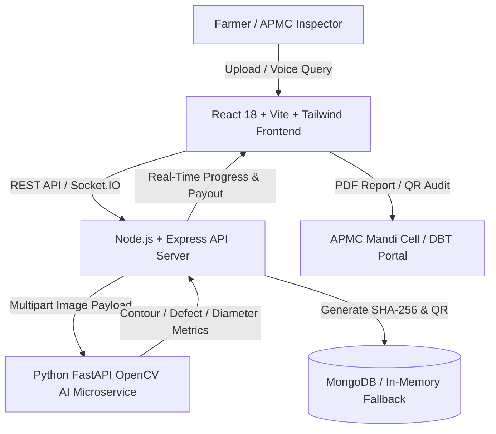

# 🌾 Harvest Heist — AI Onion Grading & Procurement Ecosystem
### Smart India Hackathon 2026 — Problem Statement SIH26031
**Product Identity:** OnionGrade AI  
**Tagline:** "AI-powered onion quality assessment, transparent grading, and tamper-evident procurement."

---

## 🛠 1. Complete Technology Stack & Architecture

Harvest Heist is structured as a decoupled, microservice-based architecture designed for high throughput, modular ML model swapping, and offline edge resiliency.



### Stack Components:
- **Frontend (Web Application):**
  - **Framework:** React 18, Vite, TypeScript
  - **Styling:** Tailwind CSS (Custom Red Onion Ruby & Amber skin palette with dark glassmorphism)
  - **Visualizations:** Recharts (Grade distribution, defect breakdown, price trends)
  - **Real-Time Communication:** Socket.IO Client
  - **Document & Receipt Generation:** HTML5 Canvas, QRCode.react, JSPDF/Print stylesheets
  - **Voice AI:** HTML5 Web Speech API (SpeechRecognition + SpeechSynthesis)

- **Backend API (Node.js Service):**
  - **Server Engine:** Express.js, Socket.IO Server
  - **Database Connector:** Mongoose ODM with automated **Zero-Config In-Memory Fallback Engine**
  - **Cryptographic Security:** Node.js `crypto` module (SHA-256 blockchain tamper-evident receipts)
  - **Payout Engine:** Simulated Price Stabilization Fund & Direct Benefit Transfer (DBT) calculator

- **AI Microservice (Python Service):**
  - **Framework:** FastAPI, Uvicorn
  - **Computer Vision:** OpenCV (`opencv-python-headless`), NumPy, Pillow
  - **Detection Logic:** Color space thresholding (HSV), contour blob segmentation, pixel-to-millimeter diameter scaling
  - **YOLO Stub Integration:** Modular stub interface pre-configured for ultralytics YOLOv8 / Roboflow swapping without API contract changes

---

## 🚀 2. Key Innovative Features Implemented

1. **Computer Vision Bounding Box Inspection Overlay:**
   - Detects healthy, damaged, rotten, sprouted, undersized, and discolored onions.
   - Interactive canvas displaying SVG bounding boxes, color-coded defect tags, and millimeter diameter measurements.

2. **Transparent Deductions & Explainable Scoring:**
   - Deductions start at a score of 100 with standardized penalty math:
     - **Rotten:** -30 pts/count
     - **Sprouted:** -20 pts/count
     - **Damaged:** -15 pts/count
     - **Undersized:** -10 pts/count
     - **Discolored:** -10 pts/count
   - Auto-generates plain-language explainability strings for every grade decision.

3. **Tamper-Evident SHA-256 Blockchain Smart Receipts:**
   - Computes a cryptographic SHA-256 hash of batch parameters (`batchId`, `farmerId`, `quantity`, `qualityScore`, `finalAssignedGrade`, `timestamp`).
   - Generates a live scannable QR code on digital quality reports for dispute-proof mandi audit trails.

4. **Automated MSP & Direct Benefit Transfer (DBT) Payout Trigger:**
   - Calculates baseline payout using the Price Stabilization Fund rate (₹2,125/quintal baseline).
   - Generates simulated DBT transaction references (`DBT-MH-ONION-XXXX`).

5. **Multilingual Voice AI Assistant (Hindi / Marathi / English):**
   - Web Speech API voice listener supporting regional languages.
   - Spoken text-to-speech audio feedback on batch grades, MSP rates, and mandi prices.

6. **Predictive Mandi Price & Congestion Forecasting:**
   - Time-series price trends across regional APMC hubs (Pune, Lasalgaon, Ahmednagar, Solapur).
   - Congestion heatmap recommending optimal sell timing window (e.g. 48h window).

7. **Offline-First Edge Sync Indicator:**
   - Simulates local edge AI processing with automatic cloud re-sync (`isOfflineSynced: true`) for remote procurement centers.

---

## 🏃 3. Step-by-Step Local Run Instructions

All services run out-of-the-box with zero paid APIs or external dependencies.

```bash
# Ensure Node binary is in PATH (if portable node installed):
export PATH=$HOME/.local/node/bin:$PATH

# 1. Start Python AI Microservice (Port 8088):
cd ai-service
venv/bin/python main.py

# 2. Start Node.js Backend API (Port 5001):
cd backend
node src/server.js

# 3. Start React Frontend Web App (Port 3000):
cd frontend
npm run dev
```

- **Live Local Link:** [http://localhost:3000](http://localhost:3000)

---

## 🎯 4. Demo Login Credentials

- **Farmer View:** Ramesh V. Patil (`FARM_101`) • Manchar, Pune
- **Inspector / APMC View:** Officer V. K. Deshmukh (`INS_001`) • Pune APMC Yard
- **Admin View:** Director A. K. Verma (`ADMIN_001`) • APMC Board

---

## 🔌 5. YOLOv8 Production Model Swapping Protocol

To plug in a trained YOLO model or Roboflow endpoint:
1. Install ultralytics: `ai-service/venv/bin/pip install ultralytics`
2. Place `best.pt` in `ai-service/`
3. Update `ai-service/analyzer.py` to instantiate `YOLO("best.pt")`.
4. The Node.js backend API contract requires **zero changes**.
